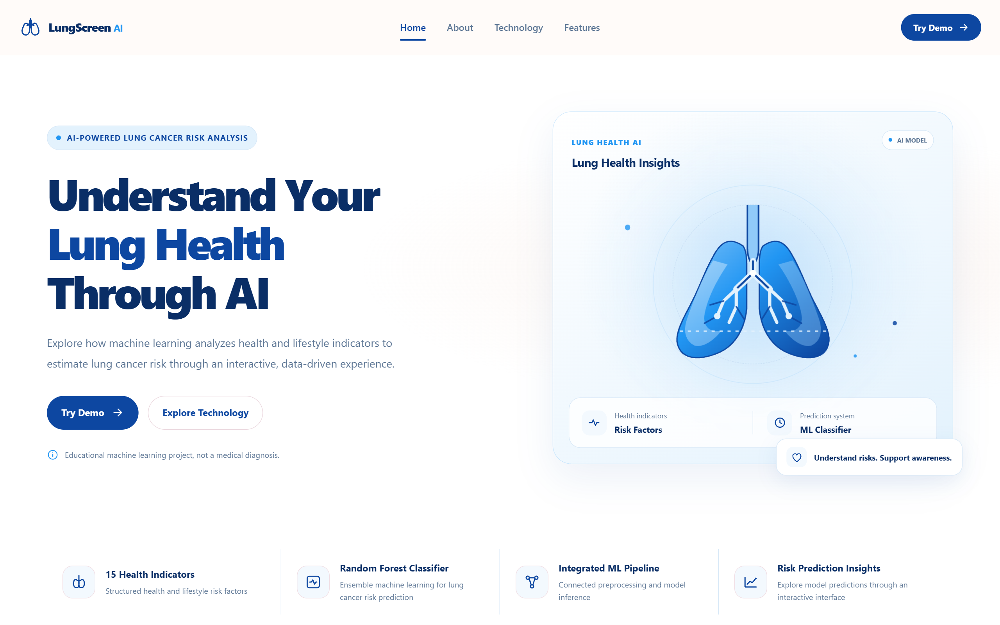

# LungScreen AI
### AI-Powered Heart Health Assessment


<p align="center">
  <a href="https://lungscreen-ai.onrender.com/">
    
  </a>
  <a href="https://github.com/javieresoares/lungscreen-ai">
    
  </a>
</p>

## Live Demo

**Try CardioLens AI:** [https://lungscreen-ai.onrender.com/](https://lungscreen-ai.onrender.com/)

> The free Render instance may take a little time to wake up after a period of inactivity.

## Application Preview

<p align="center">
  
</p>


LungScreen AI is an educational machine learning web application that demonstrates how cardiovascular health indicators can be used to generate heart disease prediction results using a Random Forest classifier.

The project combines data exploration and model experimentation in Google Colab with a Flask-based web application, creating an end-to-end machine learning portfolio project.

> **Disclaimer:** This project is intended for educational and portfolio purposes only. It is not a medical diagnostic tool and must not be used to make healthcare decisions.

---

## Project Overview

LungScreen demonstrates a machine learning workflow from dataset exploration and model evaluation to web application deployment.

Data exploration, preprocessing, baseline model comparison are performed in Google Colab. The selected Random Forest classifier is integrated into a Flask application that allows users to submit lung health indicators and view the model's prediction output.

### Key Features

- **Exploratory Data Analysis** — Investigate the dataset and target distribution in Google Colab.
- **Data Preparation** — Prepare features and target labels for model experiments.
- **Baseline Model Comparison** — Evaluate eight classification algorithms using accuracy, recall, precision, and F1-score.
- **Random Forest Integration** — Integrate the selected KNN classifier into the web application.
- **Interactive Assessment** — Submit 15 lung health indicators through a web form.
- **Visualization Reports** — Store plots from data analysis and model experiments.
- **Flask Web Application** — Serve the assessment interface and prediction functionality.

---

## Technology Stack

| Component | Technology |
|---|---|
| Programming Language | Python |
| Data Exploration | Google Colab |
| Notebook | Jupyter Notebook |
| Data Processing | Pandas, NumPy |
| Machine Learning | Scikit-learn |
| Additional Model | XGBoost |
| Model Serialization | Joblib / Pickle |
| Backend | Flask |
| Frontend | HTML5, CSS3, JavaScript |
| Styling | Tailwind CSS CDN |
| Version Control | Git, GitHub |
| Deployment Target | Render |

---

## Project Structure

```text
heart-disease/
│
├── app.py
├── requirements.txt
├── README.md
├── .gitignore
│
├── data/
│   └── lung-cancer-dataset.csv
│
├── notebook/
│   └── lung-cancer.ipynb
│
├── models/
│   └── [trained model and preprocessing artifacts]
│
├── reports/
│   ├── target-distribution-before.png
│   ├── target-distribution-after.png
│   ├── naive-bayes-baseline.png
│   ├── logistic-regression-baseline.png
│   ├── knn-baseline.png
│   ├── svm-baseline.png
│   ├── decision-tree-baseline.png
│   ├── random-forest-baseline.png
│   ├── gradient-boosting-baseline.png
│   └── xgboost-baseline.png
│
├── templates/
│   └── index.html
│
└── static/
    ├── css/
    │   └── style.css
    ├── js/
    │   └── script.js
    └── images/
        ├── lungscreen-social-preview.png
        ├── site.webmanifest
        ├── android-chrome-192x192.png
        ├── android-chrome-512x512.png
        ├── apple-touch-icon.png
        ├── favicon.ico
        ├── favicon-16x16.png
        └── favicon-32x32.png
```

**Structure notes:**

- `data/` stores the dataset used for the project.
- `notebook/lung-cancer.ipynb` contains the notebook used for experimentation in Google Colab.
- `models/` stores the trained classifier and any preprocessing artifacts required by Flask.
- `reports/` contains visualizations generated during analysis and model evaluation.
- `templates/` contains the HTML template.
- `static/` contains CSS, JavaScript, favicon files, and social preview assets.

The dataset and model filenames above are illustrative. Replace them with the actual filenames used in the repository.

---

## Data Exploration and Experimentation

Data exploration and machine learning experiments are conducted in **Google Colab** using the notebook:

`notebook/lung-cancer.ipynb`

The notebook is the primary workspace for:

1. Loading and inspecting the dataset.
2. Examining target distribution before and after data preparation.
3. Exploring feature characteristics and data quality.
4. Preparing input features and target labels.
5. Comparing baseline classification algorithms.
6. Evaluating classification performance.
7. Exporting the selected model and required preprocessing artifacts.

The notebook is retained in the repository so that the experimental workflow can be reviewed alongside the deployed application.

### Experimentation Workflow

1. Load the dataset into Google Colab.
2. Perform data exploration and preparation.
3. Evaluate baseline classification models.
4. Compare accuracy, recall, precision, and F1-score.
5. Select the model configuration for application integration.
6. Export the required model artifacts.
7. Load and test the artifacts in the Flask application.

The Flask application uses the exported model artifacts for inference. It does not need to rerun the notebook or retrain the classifier for each prediction.

---

## Dataset

The project uses a lung cancer dataset stored in the `data/` directory.

The dataset is explored in Google Colab to understand its structure, target distribution, and input features before model experimentation.

The exact dataset source, number of records, preprocessing details, and class distribution should be documented from the actual dataset and notebook results.

### Analysis Reports

The `reports/` directory stores visual outputs from the experimentation workflow, including:

- Target distribution before and after data preparation.
- Heatmap corelation feature and target.
- Baseline results for eight classification algorithms.

These visualizations support the documentation of model comparison and evaluation.

---

## Machine Learning Workflow

### 1. Exploratory Data Analysis

Inspect the dataset, understand its characteristics, and examine the target distribution in Google Colab.

### 2. Data Preparation

Prepare the features and target labels for classification experiments. Apply the preprocessing required by each model.

### 3. Baseline Model Comparison

Evaluate eight classification algorithms using four metrics:

- Accuracy
- Recall
- Precision
- F1-score

### 5. Model Selection

Compare the reported evaluation metrics, considering overall classification performance and the ability to identify positive cases.

Random Forest was selected for integration into the LungScreen AI application because it achieved the highest accuracy and F1-score among the eight evaluated models.

### 6. Model Export and Integration

Export the selected classifier and any required preprocessing artifacts from the experimentation environment. Load these artifacts in Flask using the same feature order and preprocessing transformations expected during training.

### 7. Web-Based Prediction

Users submit 15 lung health indicators through the assessment form. Flask processes the input and returns the classifier's prediction.

---

## Baseline Model Evaluation

The following table summarizes the model evaluation results for LungScreen AI.

| Model | Accuracy | Recall | Precision | F1-Score |
|---|---:|---:|---:|---:|
| Naive Bayes | 0.8929 | 0.9583 | 0.9200 | 0.9388 |
| Logistic Regression | 0.8929 | 0.9583 | 0.9200 | 0.9388 |
| K-Nearest Neighbors | 0.8929 | 0.9792 | 0.9038 | 0.9400 |
| Support Vector Machine | 0.8571 | 0.9583 | 0.8846 | 0.9200 |
| Decision Tree | 0.9107 | 0.9167 | 0.9778 | 0.9462 |
| Random Forest | 0.9286 | 0.9583 | 0.9583 | 0.9583 |
| Gradient Boosting | 0.8750 | 0.9375 | 0.9184 | 0.9278 |
| XGBoost | 0.8571 | 0.9375 | 0.9000 | 0.9184 |

### Baseline Findings

- **Highest baseline accuracy**: Random Forest at 0.9286.
- **Highest baseline recall**: K-Nearest Neighbors at 0.9792.
- **Highest baseline precision**: Decision Tree at 0.9778.
- **Highest baseline F1-score**: Random Forest at 0.9583.

These results show that different algorithms perform differently across the evaluation metrics. Random Forest achieved the highest accuracy and F1-score, while K-Nearest Neighbors achieved the highest recall and Decision Tree achieved the highest precision. No single metric fully captures every aspect of classification performance.

---

### Model Selection Rationale

The Random Forest model was selected for integration into LungScreen AI because it achieved the highest accuracy (0.9286) and F1-score (0.9583) among the eight evaluated classification models.

Its recall of 0.9583 indicates that it identified a high proportion of positive cases in the evaluated dataset. Meanwhile, K-Nearest Neighbors achieved the highest recall at 0.9792. These results should be interpreted within the context of the dataset and evaluation procedure; they do not establish clinical effectiveness or guarantee accurate predictions for individual patients.

---

## Model Input Features

The assessment interface uses 15 lung health indicators.

| Feature | Description |
|---|---|
| `gender` | Encoded gender category |
| `age` | Age in years |
| `smoking` | Smoking indicator |
| `yellow_fingers` | Yellow fingers indicator |
| `anxiety` | Anxiety indicator |
| `peer_pressure` | Peer pressure indicator |
| `chronic_disease` | Chronic disease indicator |
| `fatigue` | Fatigue indicator |
| `allergy` | Allergy indicator |
| `wheezing` | Wheezing indicator |
| `alcohol_consuming` | Alcohol consumption indicator |
| `coughing` | Coughing indicator |
| `shortness_of_breath` | Shortness of breath indicator |
| `swallowing_difficulty` | Swallowing difficulty indicator |
| `chest_pain` | Chest pain indicator |

Categorical values must follow the encoding scheme used during training. The Flask application must use the same feature order and preprocessing transformations expected by the saved model.

---

## Getting Started

### Prerequisites

- Python installed locally.
- pip for Python package management.
- Git for version control.
- The trained model and required preprocessing artifacts.
- Google Colab for reviewing or rerunning experiments.

### 1. Clone the Repository

```bash
git clone https://github.com/javieresoares/lungscreen-ai.git
cd lungscreen-ai
```

The repository URL above points to the LungScreen AI project.

### 2. Create a Virtual Environment

**Windows:**

```bash
python -m venv venv
venv\Scripts\activate
```

**macOS / Linux:**

```bash
python3 -m venv venv
source venv/bin/activate
```

### 3. Install Dependencies

```bash
python -m pip install -r requirements.txt
```

### 4. Verify Model Artifacts

Confirm that all required model and preprocessing files are present at the paths referenced by `app.py`.

The artifacts must be compatible with the installed Python libraries and the preprocessing workflow used during training.

### 5. Run the Application

```bash
python app.py
```

Open the application in your browser:

http://127.0.0.1:5000

This address is accessible from the computer running the application. A public deployment is required for access by other users.

---

## Deployment

CardioLens AI is designed to be deployable as a Python web service on Render.


The current public deployment is available at:
[https://lungscreen-ai.onrender.com/](https://lungscreen-ai.onrender.com/)


### General Deployment Workflow

1. Push the project to GitHub.
2. Create a new Web Service in Render.
3. Connect the GitHub repository.
4. Configure the build command.
5. Configure the production start command.
6. Ensure model artifacts are available during deployment.
7. Test the deployed website and prediction functionality.

Assuming the Flask instance is named `app` in `app.py`, a typical Render configuration is:

**Build Command**

```bash
pip install -r requirements.txt
```

**Start Command**

```bash
gunicorn app:app
```

Adjust these commands if the application entry point or Flask instance name differs.

---

## Responsible Use

- This project is intended for educational and portfolio purposes only.
- Predictions are model outputs, not confirmed medical diagnoses.
- Model performance may be affected by limitations or biases in the training data.
- Predictions must not replace professional medical evaluation.
- Avoid entering identifiable or sensitive patient information into a public demo.
- Do not use the application for clinical decision-making.

## Limitations

- Model performance depends on the dataset, preprocessing, validation strategy, and training configuration.
- The reported evaluation metrics do not establish clinical validity.
- The application is not a validated clinical decision-support system.
- Performance on unseen data may differ from the reported results.
- Hosting availability and response time depend on the deployment service.

---

## Future Improvements

Potential improvements include:

- Documenting the dataset source and preprocessing decisions.
- Adding automated tests for input validation and prediction routes.
- Improving error handling and monitoring.
- Optimizing frontend performance and accessibility.
- Recording model versions and dependency versions.
- Improving reproducibility between Google Colab and production inference.
- Adding deployment health checks and continuous integration.

---

## License

No license has been specified yet. Unless a license is added to this repository, reuse and redistribution are not automatically granted.

---

**CardioLens AI**  
*An educational machine learning project exploring cardiovascular health prediction.*
